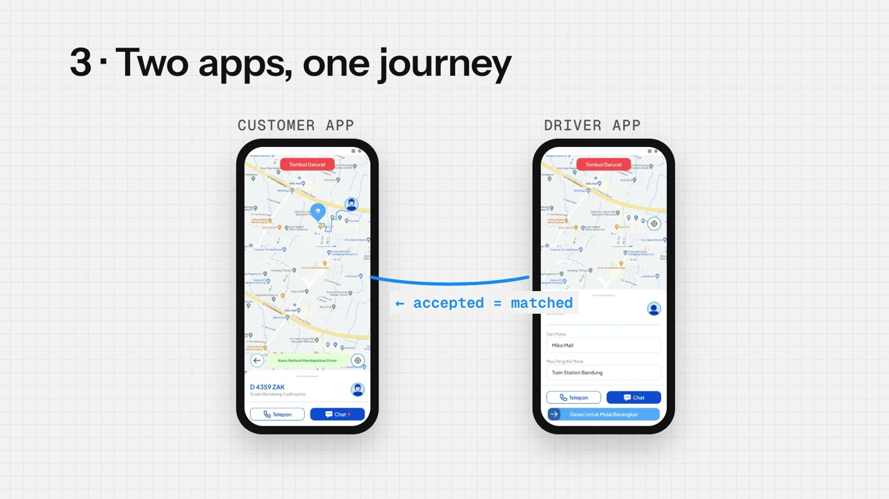
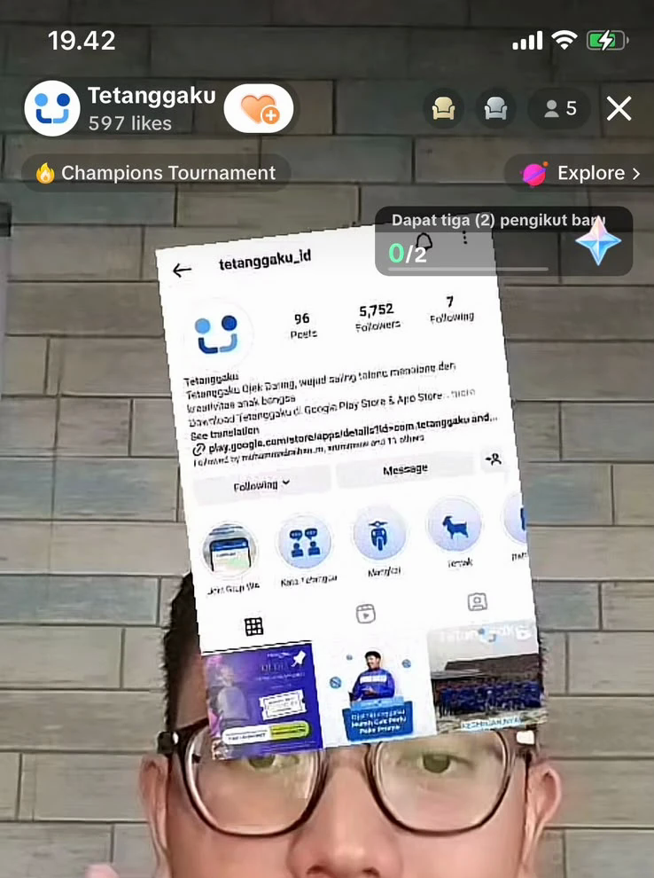

# Tetanggaku: Designing a Ride-Hailing Ecosystem as the Only Designer

**A small team set out to compete with Gojek and Grab. As the only designer for two years, I designed every screen across three apps, which together passed 100K downloads.**

[**Read the full case study →**](https://raamportfolio.vercel.app/work/tetanggaku) · [Watch the 70-second video](https://raamportfolio.vercel.app/work/tetanggaku#watch) · [See it on Google Play](https://play.google.com/store/apps/details?id=com.tetanggaku)

---

## Overview

| | |
|---|---|
| **Company** | Tetanggaku (PT. Tetangga Saling Bantu), Indonesia |
| **Role** | Sole UI/UX designer (freelance), working directly with the PM, CEO and CTO |
| **Timeline** | Apr 2022 – Mar 2024 |
| **Apps** | Customer · motorbike driver · car driver (Android) |
| **Outcome** | **100K+ downloads** and **4.3★ on Google Play** from 2,200+ reviews |

---

## The challenge

Tetanggaku, "my neighbour", entered a market where riders and drivers already know Gojek and Grab inside out. The team was small, briefs were usually verbal, and there was no other designer, so the experience had to be right without the time or people to explore widely.

| | |
|---|---|
| **100K+** | downloads |
| **4.3★** | on Google Play, 2,200+ reviews |
| **3** | apps, one designer |

---

## Three decisions

### 1. Familiar patterns over novel ones

- **Context:** every rider and driver in Indonesia already knows how Gojek and Grab work.
- **Instead of:** designing a distinctive new booking flow to stand out.
- **Why:** a new flow would force people to relearn something they do daily, for no benefit. A small team's effort was better spent making the familiar flows clear and quick.
- **Result:** I studied both leaders' flows and adapted their proven patterns to what our team could build and maintain.

### 2. Straight to high fidelity, with early alignment

- **Context:** requirements arrived as verbal briefs, and the business needed screens fast.
- **Instead of:** the textbook path of wireframes, then low fidelity, then high fidelity.
- **Why:** with one designer, each extra stage delayed delivery. Shaping requirements with the PM and aligning with the CEO and CTO up front reduced the risk of skipping stages.
- **Result:** I designed directly in high fidelity and walked the team through each journey before it was built.

### 3. Design both sides of every trip together

- **Context:** a ride involves two people looking at two different apps at the same moment.
- **Instead of:** designing the customer app first and treating the driver apps as an afterthought.
- **Why:** a confused driver means a late ride, so driver experience is customer experience.
- **Result:** customer and driver screens were designed as one journey, so what a rider sees always matches what their driver sees. When the driver accepts an order, the rider sees they're matched.

---

## What I designed

- **Customer app:** motorbike and car rides, item delivery (Titip), e-wallet, referral program and more.
- **Motorbike driver app:** receiving and managing orders, e-wallet, referral program and more.
- **Car driver app:** the same core flows, adapted for car trips.

---

## Close to the users

In my last few months at Tetanggaku, the team also asked me to host its **TikTok Live** for about three months: teaching drivers how to use the app and promoting the service.

It turned into a regular feedback loop. Drivers asked their questions live, and where they got stuck showed me what wasn't clear yet. Some of that feedback went straight back into the design.

---

## What I'd do differently

- **Build a small component library earlier.** Designing three apps alone, shared components would have kept them consistent with less effort.
- **Write lightweight specs.** Verbal briefs were fast, but a one-page summary per feature would have reduced back-and-forth during development.

---

[Raam Pujangga Sadewa](https://raamportfolio.vercel.app) · Product Design Engineer
